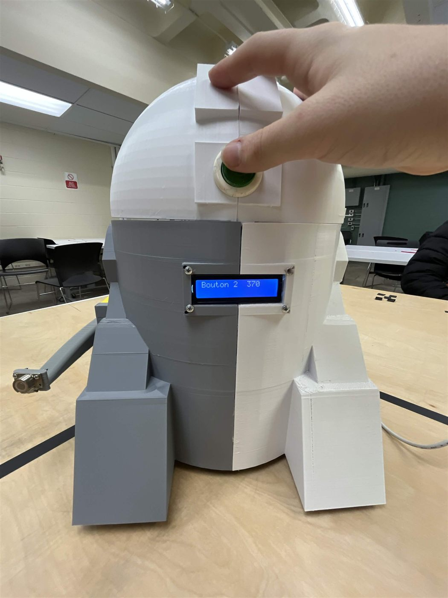
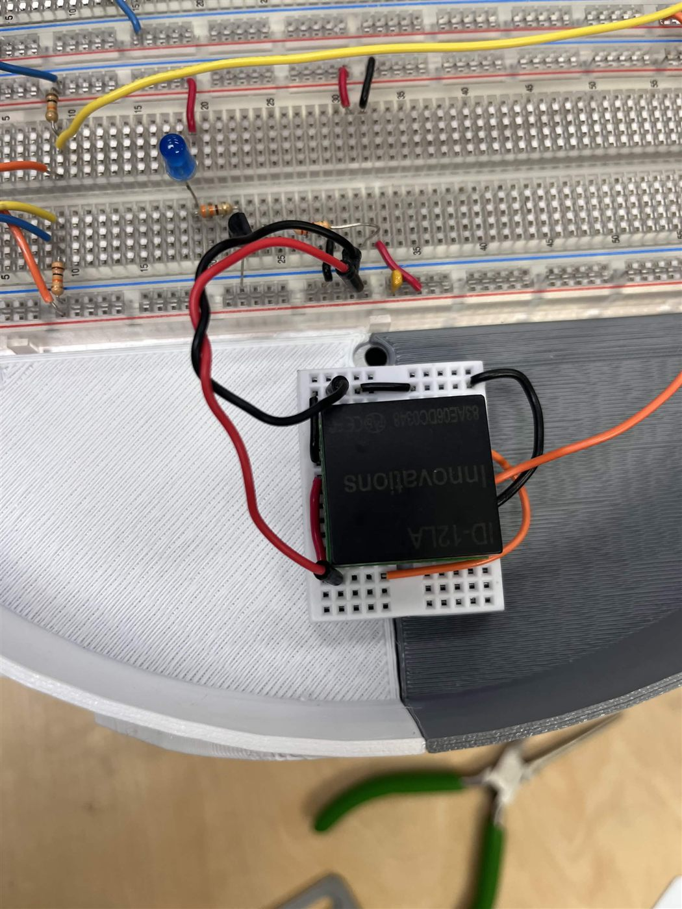
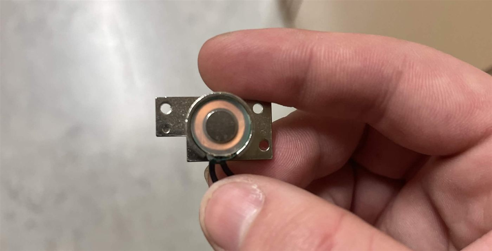
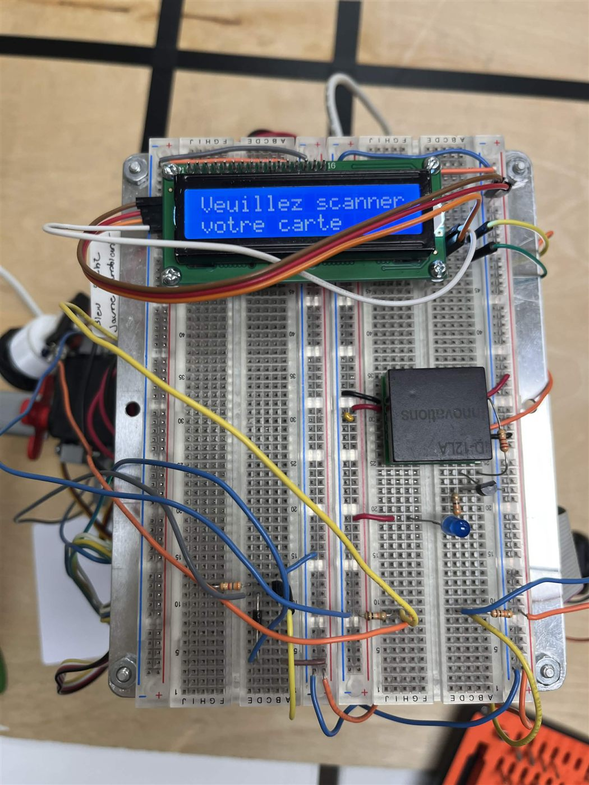

# R2D2 Inventory Robot — Gestion de casiers par RFID

> Robot R2D2 imprimé en 3D qui attribue un casier à une carte RFID, livre une clé puis la récupère.
>
> *3D-printed R2D2 robot that assigns a locker to an RFID card, delivers a key and later retrieves it.*




*Le robot R2D2 et son écran LCD affichant l'état du système.*

## Aperçu / Overview

**FR** — Projet final d'équipe (P18) : un distributeur de clés ambulant. L'utilisateur scanne sa carte RFID ; le robot choisit un casier libre, se déplace jusqu'à lui le long d'une ligne, dépose la clé avec son électroaimant, puis revient à sa position d'attente. Quand la carte est scannée à nouveau, il récupère la clé et libère le casier.

**EN** — Team final project (P18): a mobile key dispenser. The user scans an RFID card; the robot picks a free locker, drives to it along a line, drops the key with its electromagnet and returns to the waiting position. Scanning the same card again makes it fetch the key and free the locker.

## Fonctionnalités / Features

- Attribution automatique d'un casier libre (3 casiers).
- Reconnaissance d'une carte déjà enregistrée → mode « retour de clé ».
- Déplacement autonome : suivi de ligne, virages et distances odométriques.
- Électroaimant pour saisir / déposer la clé, servo pour ouvrir la trappe.
- Interface LCD 16×2 avec messages d'état et **timeout de 15 s**.
- Retours sonores (bips) à chaque étape.

## Machine à états / State machine

| État | Signification | Action |
|---|---|---|
| `0` | Attente | Affiche « Veuillez scanner votre carte » |
| `1` | Carte acceptée | Électroaimant actif, attend le bouton vert (15 s max) |
| `2` | Retour de clé | Va au casier, prend la clé, revient, libère le casier |
| `3` | Livraison | Va au casier, dépose la clé, revient, ouvre la trappe |

```cpp
Etat = scanRFID();   // 1 = nouvelle carte, 2 = carte connue, 3 = aucun casier libre
```

## Matériel / Hardware

| Élément | Rôle |
|---|---|
| Carte ArduinoX + Arduino Mega 2560 | Contrôleur |
| Lecteur RFID (liaison `Serial2`) | Identification de l'utilisateur |
| LCD I2C 16×2 (0x27) | Interface utilisateur |
| Électroaimant (D53) | Saisie / dépôt de la clé |
| Servo | Trappe du casier |
| 3 capteurs de ligne (A5, A6, A7) | Suivi de trajectoire |
| Capteur de couleur TCS34725 | Repérage des casiers |
| Boutons vert / rouge | Validation / annulation |
| Buzzer | Retours sonores |


*Module RFID monté sur le dôme du robot.*


*Électroaimant utilisé comme préhenseur pour la clé.*


*Électronique de bord : LCD, relais et capteur de couleur sur plaque.*

## Architecture / Layout

| Élément | Contenu |
|---|---|
| `src/main.cpp` | Machine à états, séquence de livraison / retour |
| `src/inventaire.cpp` | Table des casiers, lecture RFID, attribution |
| `lib/Mouvement/` | Avance, recul, rotations calibrées (encodeurs) |
| `lib/Suiveur/` | Suivi de ligne proportionnel 3 capteurs |
| `lib/CapteurCouleur/` | Lecture et classification TCS34725 |
| `lib/Setup/` | Initialisation des périphériques |
| `lib/Debug/` | Bips de diagnostic |

## Compilation / Build

```bash
pip install platformio
pio run
pio run --target upload
pio device monitor
```

Les bibliothèques tierces (`LibRobUS`, `LiquidCrystal_I2C`, `Adafruit TCS34725`) sont déclarées dans `platformio.ini`.

## Limites / Limitations

- Trois casiers seulement, avec des trajets prédéfinis.
- La table des casiers est en RAM : elle est perdue au redémarrage.
- Les seuils du capteur de couleur et du suiveur sont calibrés pour le local du cours.
- Le protocole RFID est parsé « à la main » sur `Serial2` (pas de bibliothèque dédiée).

## Ce que j'ai appris / What I learned

- Intégrer plusieurs modules (RFID, LCD, servo, électroaimant, capteurs) dans une machine à états.
- Gérer des scénarios utilisateur complets : attribution, timeout, erreur, retour.
- Réutiliser des briques logicielles d'un projet à l'autre.
- Concevoir et imprimer en 3D un châssis fonctionnel.

## Crédits / Credits

- **Projet d'équipe P18 — Université de Sherbrooke.**
- **Auteur principal** : Donavan Sirois (logique d'inventaire, intégration, châssis).
- **Modules réutilisés** : Tristan Faucher (`Mouvement`, `Suiveur`, `CapteurCouleur`, `Debug`).
- **Bibliothèque RobUS** : [UdeS-GRO/LibRobUS](https://github.com/UdeS-GRO/LibRobUS).
- Publié à des fins de portfolio avec l'accord de l'équipe.

## Licence / License

© Équipe P18 — Université de Sherbrooke. Tous droits réservés. Code publié à titre de démonstration.
